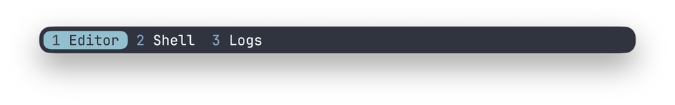
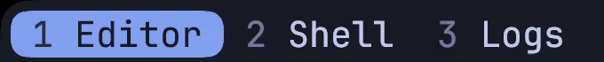
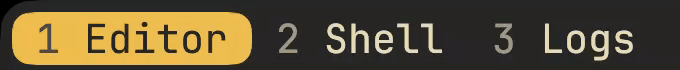

# Kitty Sliding Tabs

A minimalist tab bar for Kitty on macOS generated by AI.

<p align="center">
  <sub>Catppuccin Mocha</sub><br>
  
</p>

<p align="center">
  <sub>Nord</sub><br>
  
</p>

<p align="center">
  <sub>Tokyo Night</sub><br>
  
</p>

<p align="center">
  <sub>Gruvbox Dark</sub><br>
  
</p>

## Install

Tested on a Retina Mac with Kitty 0.50.0 and JetBrains Mono.

1. Clone this repo. Install the [corner font](fonts/KittyInsetCorners-Regular.ttf) in Font Book.
2. Copy the files from the repo folder.

   ```sh
   kitty_dir="${KITTY_CONFIG_DIRECTORY:-${XDG_CONFIG_HOME:-$HOME/.config}/kitty}"
   mkdir -p "$kitty_dir/shaders"
   cp -i tab_bar.py sliding-tabs.conf "$kitty_dir/"
   cp -i shaders/active-tab-slide-lite.* "$kitty_dir/shaders/"
   ```

3. Add `include sliding-tabs.conf` after your theme in `kitty.conf`.
4. Restart Kitty. Switch tabs.

## How to change colors

Edit these settings in `sliding-tabs.conf` and match them in `shaders/active-tab-slide-lite.slang`.

| Color | `sliding-tabs.conf` | Shader |
| --- | --- | --- |
| Tab index | `fmt.fg._RRGGBB` in both title templates | `ACTIVE_INDEX`, `INACTIVE_INDEX` |
| Tab title | `active_tab_foreground`, `inactive_tab_foreground` | `ACTIVE_TITLE`, `INACTIVE_TITLE` |
| Highlight | `active_tab_background` | `ACTIVE_BACKGROUND` |

Use hex in the config and decimal RGB in the shader. For example, `#CBA6F7` becomes `float3(203, 166, 247)`. Set `tab_bar_background` and `inactive_tab_background` to your terminal’s `background`. Restart Kitty.

## How it works

Kitty’s custom tab bar API draws the labels and rounded corner glyphs. Python tracks the highlight’s position. The shader moves it pixel by pixel behind the fixed labels in 180 ms. Kitty’s text-cell drawing API alone can move the highlight only in whole-cell steps. [Kitty tab bar documentation](https://sw.kovidgoyal.net/kitty/conf/#opt-kitty.tab_bar_style)

## Caveat

The shader needs Kitty to keep a shared offscreen texture containing the full window. That’s about 63 MiB at 3840 × 2160 with 16 bits per RGBA channel. The animation itself keeps only the transition coordinates and start time in Python. [Kitty shader renderer](https://github.com/kovidgoyal/kitty/blob/v0.50.0/kitty/shaders.c)

Crowded tab rows and unsupported font or display layouts switch instantly.
